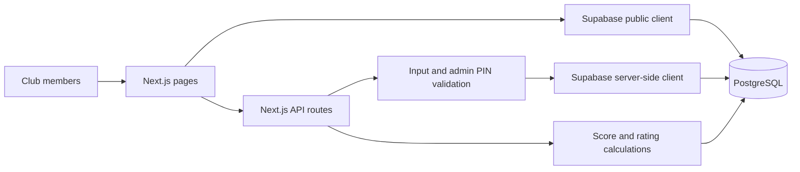

# BOS RIICHI — Mahjong Club Tracker

A small full-stack web app for recording four-player Riichi Mahjong games and keeping a shared leaderboard. I started it to replace the spreadsheets and manual score calculations used by our club, then added player statistics and tools based on how we actually play.

## What it does

- **Record games:** select four players, enter final scores, and calculate placements and PT automatically.
- **Check results:** browse match history and see each player's scores and rating changes.
- **Compare players:** sort the leaderboard by total PT, Rate, number of games, average placement, first-/fourth-place rate, and average PT.
- **Explore player profiles:** see placement distribution, PT summaries, rating/placement trends, recent games, and head-to-head records.
- **Correct records:** edit or delete games, rename players, and recalculate ratings after changes.
- **Look up hand scores:** calculate dealer/non-dealer ron and tsumo payments from han and fu, with a compact scoring reference.

The interface is primarily in Chinese because it was built for our group.

## Tech stack

| Layer | Tools |
| --- | --- |
| Frontend | Next.js (App Router), React, TypeScript, CSS |
| Backend | Next.js Route Handlers (API endpoints) |
| Data | Supabase, PostgreSQL |
| Deployment | Configured for deployment on Vercel |

## How it works



The database separates players, games, individual game results, and rating history. Recording or modifying a match updates the stored results and triggers a recalculation of the club's ratings.

For the code structure, data model, and trade-offs, see [Architecture notes](docs/architecture.md).

## Scoring rules

The match tracker uses a fixed four-player, half-game configuration based on the M.LEAGUE placement point system:

- Starting points: **25,000** per player
- Return points: **30,000**
- Placement points: **+50 / +10 / -10 / -30** (1st through 4th)
- Final PT: `(final points - 30,000) / 1,000 + placement points`

Each recorded match must have **four distinct players** and final scores totaling **100,000**. Tied placements are not supported by the current database schema.

**Rate** is a separate, custom club rating system initialized at 1500; it is not an official Mahjong rating. See [the calculation code](lib/rating.ts).

## Run locally

**Requirements:** Node.js, npm, and a Supabase project.

1. Clone this repository and install dependencies:

   ```bash
   git clone https://github.com/xzkp861/riichi-club.git
   cd riichi-club
   npm install
   ```

2. In your Supabase project's SQL Editor, run the migrations **in order**:

   - `supabase/migrations/001_init.sql`
   - `supabase/migrations/002_rating_history.sql`

3. Copy the example environment file:

   ```bash
   cp .env.example .env.local
   ```

4. Fill in the variables in `.env.local`:

   | Variable | Purpose |
   | --- | --- |
   | `NEXT_PUBLIC_SUPABASE_URL` | Supabase project URL |
   | `NEXT_PUBLIC_SUPABASE_PUBLISHABLE_KEY` | Supabase publishable / public client key |
   | `SUPABASE_SECRET_KEY` | **Server-only** Supabase secret key for privileged operations |
   | `ADMIN_PIN` | Private PIN required for data-changing requests |

5. Run the development server:

   ```bash
   npm run dev
   ```

   Open [http://localhost:3000](http://localhost:3000).

You can also run `npm run build` to check the production build. For deployment on Vercel, configure the same environment variables in the project settings.

> **Important:** Never commit `.env.local`, the Supabase secret key, or your real admin PIN. Only `NEXT_PUBLIC_*` variables are intended for browser access.

## Current scope and next steps

This is a personal club tool, **not a production-ready multi-tenant platform**. Read access is public, while data changes use a shared admin PIN. The current project does not implement per-user accounts, automated test coverage, or transactional match updates. Potential next steps include stronger authentication, tests for score/rating calculations, and more resilient database updates.

---

**Repository:** [github.com/xzkp861/riichi-club](https://github.com/xzkp861/riichi-club)
